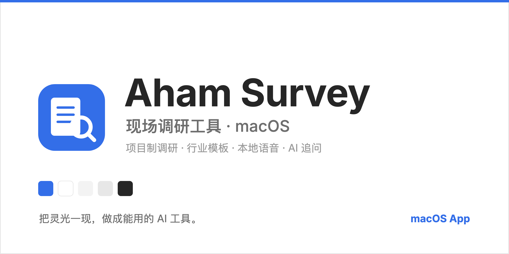
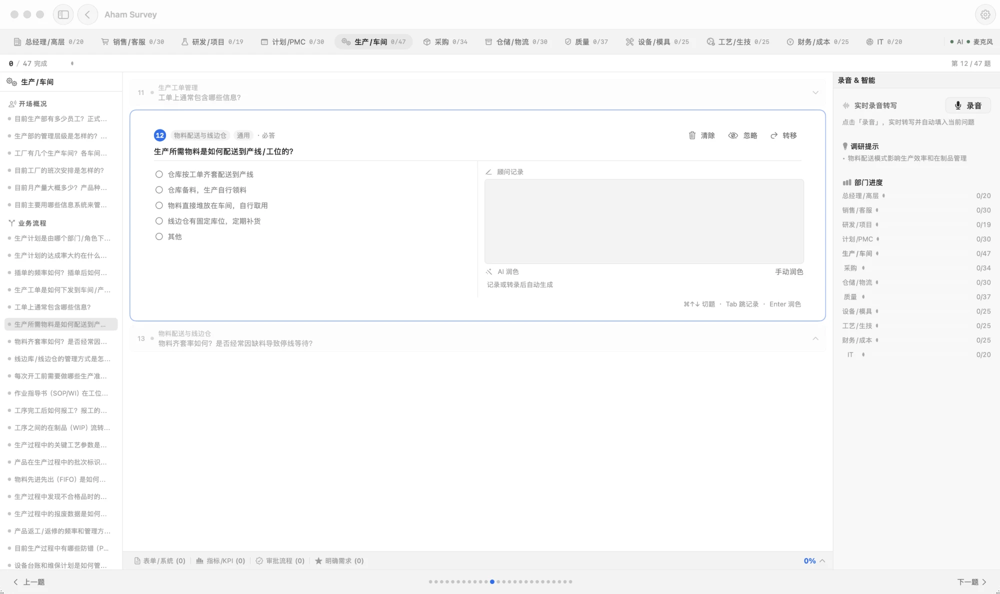
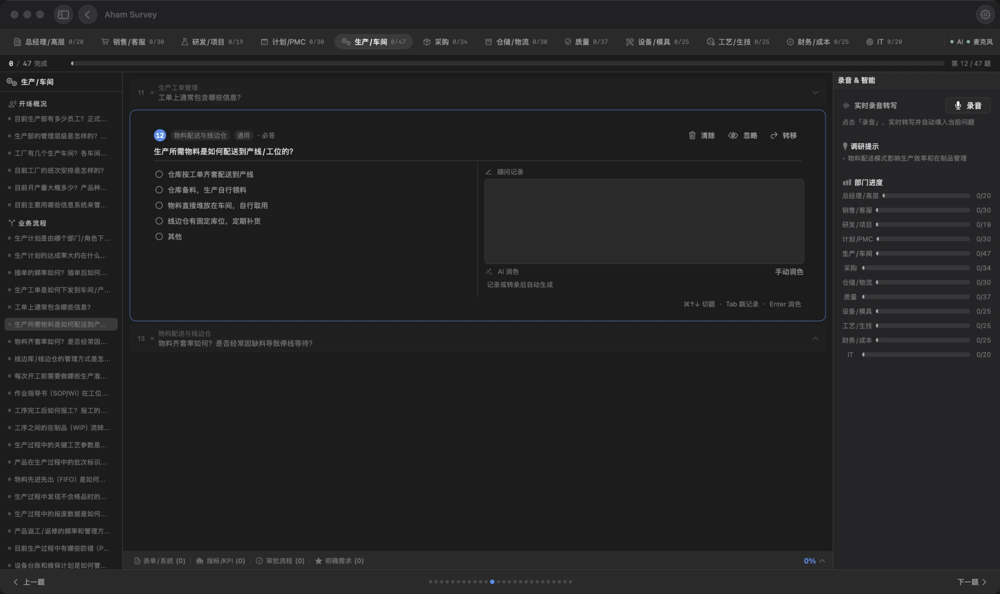

# Aham Survey — 现场调研工具（macOS）

[](https://github.com/Aham-AIAPP/aham-survey/releases)
[](LICENSE)
[](https://github.com/Aham-AIAPP/aham-ui)
[](#)
[](assets/wechat-qr.png)



## 为什么做

做 ERP / MES / WMS 这类信息化项目的售前与实施调研，现场常常一边聊一边手记，回去再对着录音和零散笔记重整理——费时，还容易漏细节、丢掉部门之间的对应关系。

Aham Survey 为此而做：它不止于「记下来」，而是把现场调研全流程结构化——按项目、按部门组织问卷，边问边记，把对话沉淀成有结构、可导出的调研成果。

它把「生成」和「采集」拆开了：**建项目、出问卷、回写答案这些交给 Claude / Codex 通过 MCP 做，App 只负责现场采集、当场提醒和导出**。所以 App 里没有「新建项目」按钮——那件事 AI 做得比表单好。

## 定位

- **专业** — 围绕真实售前 / 实施调研流程设计：项目、部门问卷、聚焦式问答。
- **结构化** — 调研不是散记，而是按项目 / 部门 / 章节组织的成果，结束即可导出。
- **本地优先** — 数据存本机（SwiftData），MCP 服务只绑 `127.0.0.1`，AI 用你自行配置的 LLM Key。
- **一致** — 与系列共用 Aham UI v10.1 设计语言，亮 / 暗双色。

> 简言之：把现场对话做成能交付的结构化调研结果，而不是停在零散笔记。

## 能做什么

- **MCP 驱动** — 建项目、回写答案、注入转写、导出报告全部交给 Claude / Codex；App 首页就是接入控制台。
- **项目制调研** — 状态分进行中 / 草稿 / 已完成 / 已归档，可归档、导出。
- **部门模板** — 按调研范围（ERP / MES / WMS / PLM / QMS / APS / 全面诊断）自动匹配部门与题目。
- **聚焦式问答** — 三卡堆叠问题流，⌘↑ / ⌘↓ 切题，⌘⇧P 润色当前记录，左侧按章节导航。
- **风险提醒** — 题库内置触发规则，答到缺失 / 异常项当场给出提示，离线可用、不依赖 AI。
- **现场追问（自行配置 LLM Key）** — 根据回答生成追问建议，可一键采纳为二级问题；记录润色手动触发。
- **导出** — Markdown 报告、Word 文档、单部门导出；也可让 Claude 直接取走 Markdown。

## 预览

> 同一套 Aham UI v10.1 设计语言 · 亮 / 暗双色。

<table>
<tr>
<td width="50%"></td>
<td width="50%"></td>
</tr>
<tr>
<td align="center"><sub>亮色 · 部门分栏 + 聚焦式问答 + 顾问记录</sub></td>
<td align="center"><sub>暗色 · 智能提示 + 部门进度</sub></td>
</tr>
</table>

## 开始使用

[**↓ 下载最新版（.dmg）**](https://github.com/Aham-AIAPP/aham-survey/releases/latest)（仅 Apple Silicon）。拖入「应用程序」；首次打开右键 → 打开，或终端执行 `xattr -dr com.apple.quarantine "/Applications/Aham Survey.app"` 解除隔离。AI 能力在「设置」里填自己的 LLM API Key（仅存本机）。

**接入 MCP**：打开 App，首页会显示服务状态与不含明文 Token 的接入配置。需要 Node 18+，适配器和机器可读契约随 App 分发。连接后会提供 15 个工具、4 个 Prompt 和 2 个 Resource，覆盖能力预检、建项目、读题、答案预览/确认、幂等写入、导出、变更日志和撤销。

**安装 Agent Skill**：仓库内的 [`.agents/skills/aham-survey`](.agents/skills/aham-survey/SKILL.md) 是 Codex、Claude Code、VS Code 共用的业务工作流；安装器也能合并 Claude Desktop 的本机 MCP 配置，Cursor 不发现 Skill 时会生成 Rules 降级壳。安装脚本默认只预演，确认目标路径后再加 `--apply`：

```sh
node .agents/skills/aham-survey/scripts/install-client.mjs \
  --client codex \
  --adapter "/Applications/Aham Survey.app/Contents/Resources/aham-survey-mcp.mjs" \
  --config "$HOME/Library/Application Support/Aham Survey/mcp-connection.json"
```

安装后可用同目录的 `doctor.mjs` 做脱敏只读检查。访谈自动映射必须先 preview、再经用户确认 commit；题号和选项由 App 返回，未知事实保持空白。

从源码运行需 Xcode 打开 `Aham.xcodeproj`。当前仅 macOS；本仓为对外示例版，内部行业知识库（方法论 / 售前框架）已从代码与历史移除。

---

## 更新记录

[Releases](https://github.com/Aham-AIAPP/aham-survey/releases) · [CHANGELOG](CHANGELOG.md)（Keep a Changelog · SemVer） · [CONTRIBUTING](CONTRIBUTING.md) · [MIT](LICENSE)

## 关于 Aham

> 把灵光一现，做成能用的 AI 工具。Aham 来自 *aha moment*，每个工具只把一件事做利落。

| 应用 | 一句话 |
|---|---|
| [Aham UI](https://github.com/Aham-AIAPP/aham-ui) | 供 AI 消费的设计系统——写一次规范，AI 产出处处一致 |
| [Aham Word](https://github.com/Aham-AIAPP/aham-word) | 供 AI 消费的 Word 规范——AI 据规范产出处处一致的 .docx |
| **Aham Survey** | 现场调研工具（macOS）——本地优先，把现场对话做成结构化调研成果 |
| [Aham Voice](https://github.com/Aham-AIAPP/aham-voice) | 录音转写与会议纪要（macOS）——本地离线转写，纪要走你自己的模型 |
| [Aham PPT](https://github.com/Aham-AIAPP/aham-ppt) | 克制的 AI PPT 制作技能——把素材做成方案级 PPT |

### 关注 · 交流

公众号看更多 AI 工具实践与更新；也欢迎扫码加我，交流与反馈。

<p></p>
